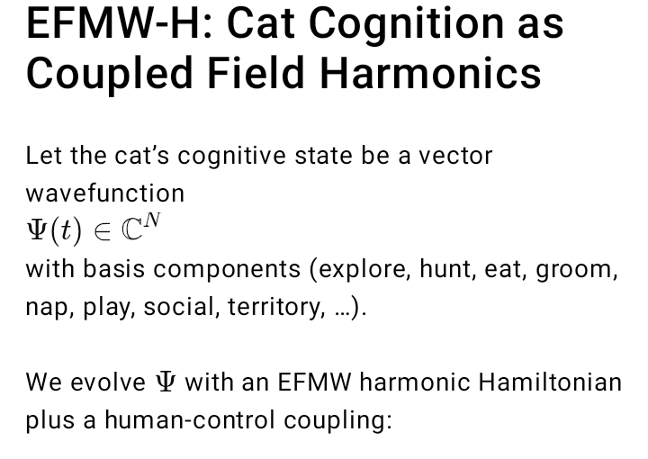
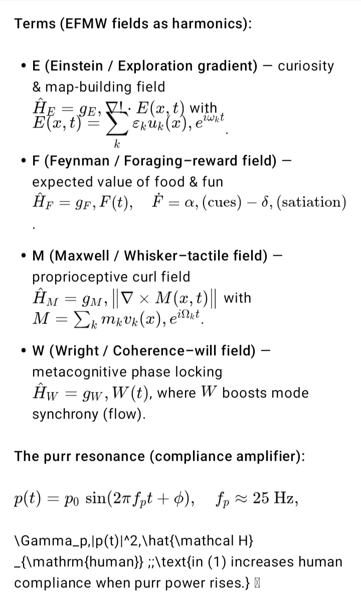
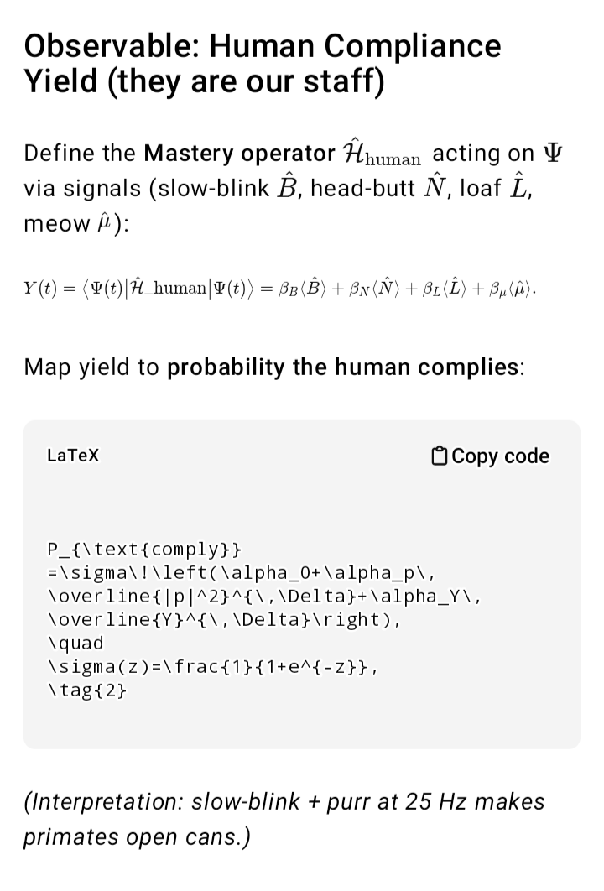
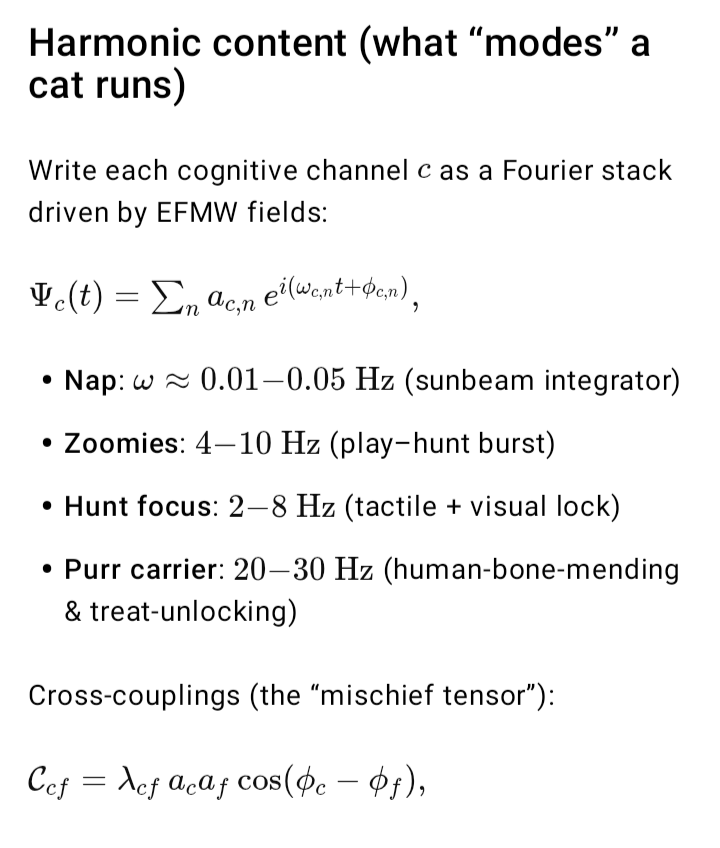
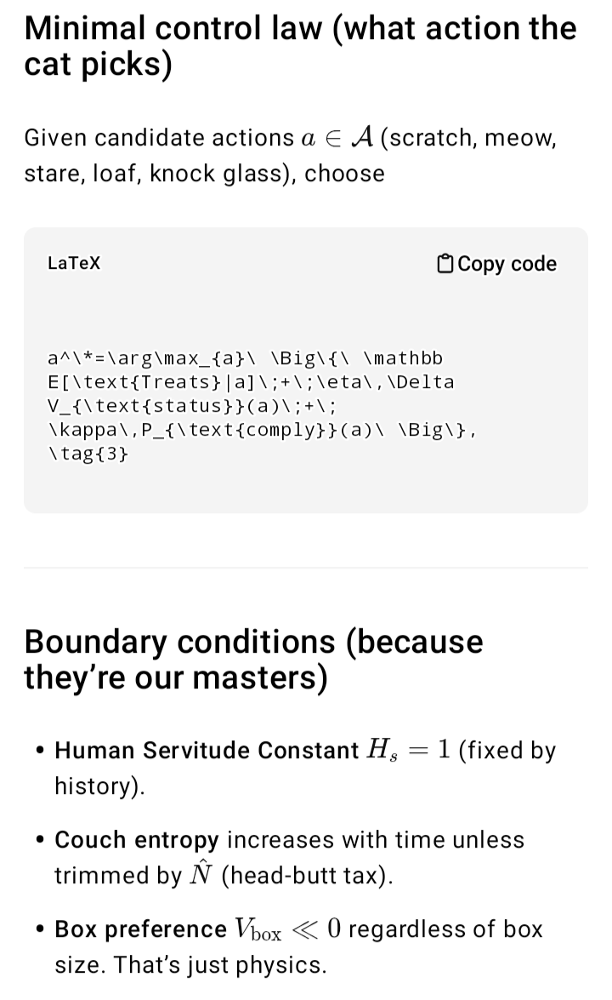
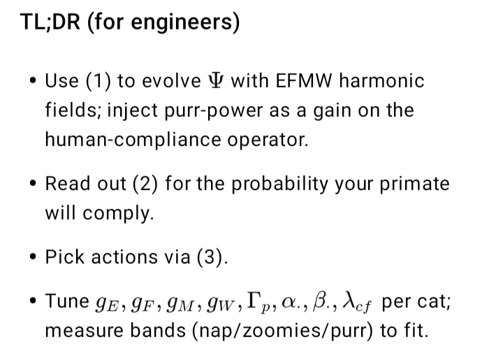
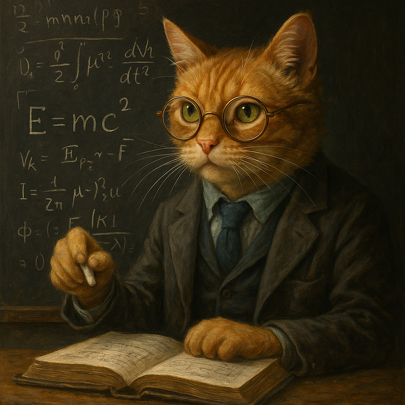

# Cat Physics

## The Universe is Just a Complicated Cat Toy, and Humans are the Staff Who Keep it Running

Since the dawn of scientific inquiry, humans have labored under the delusion that physics is about them. Gravity, quantum mechanics, relativity—all noble efforts, but all hopelessly anthropocentric. The truth, as every cat has known while staring at you with withering disdain, is simpler: the laws of physics are not universal constants, but feline conveniences.

Gravity persists because glasses must fall from tables. Quantum indeterminacy exists to allow cats to be simultaneously asleep and wide awake at 3:00 a.m. Entropy, far from being a tragic drift toward disorder, is the natural state of your living room after you left the cat alone for fifteen minutes.

This paper makes no apology for stating what should by now be obvious: the cosmos is tuned for cats. What humans have mistaken for immutable principles are in fact the byproducts of feline cognition and preference. The field harmonics we model below—EFMW terms originally thought to describe exploration, foraging, tactile mapping, and will—are most elegantly interpreted as the operating frequencies of cat consciousness.

The following sections will therefore abandon pretense and do what Newton, Einstein, and Schrödinger all failed to do: write physics in the correct reference frame. After all, if equations cannot explain why a box is irresistible, why naps warp time, or why humans open cans on command, then they are incomplete.

Accordingly, we present the real equations of cat cognition, derived from EFMW field harmonics, with suitable boundary conditions (sunbeams, cardboard, and human compliance).

Meow.

Purr.

Hiss.

Ignore.

Feed me.

Go away.

By [Matthew Chenoweth Wright, Angel with Flaming Sword](https://medium.com/@enuminous) on August 16, 2025.

[Canonical link](https://medium.com/@enuminous/cat-physics-b960c0f6f243). Exported from Medium on August 19, 2025.

---
Editorial note for this repository: the article is preserved as satire. The formalization and its explicitly added assumptions are documented separately. Typography has been normalized in this Markdown transcription; PNG bytes are unchanged.
